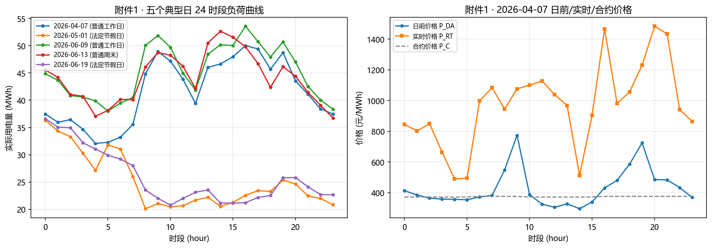
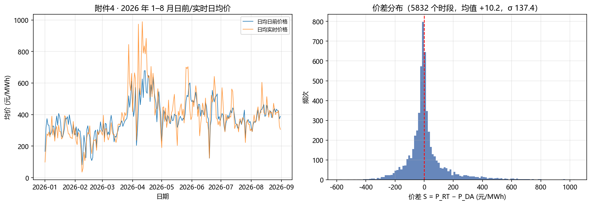

# D1 数据摸底报告（EDA）

> 生成时间：2026-10-24（D1 地基阶段） · 数据源：`data/raw/` 6 个附件 · 长表：`data/interim/`

## 1. 数据总览

| 附件 | 行数 | 日期范围 | 天数 | 关键列 |
|---|---|---|---|---|
| 附件1 典型日完全信息 | 120 | 2026-04-07 ~ 06-19 | 5 | 合约电量/价、实际负荷、日前/实时价、日期类型 |
| 附件2 用户实际用电量 | 5832 | 2026-01-01 ~ 08-31 | 243 | 实际负荷、可获得日期、星期/日期类型/节假日 |
| 附件3 平台披露预测/实际信息 | 5832×2 | 2026-01-01 ~ 08-31 | 243 | 统调负荷、A/B 类电源、风电/光伏/火电/水电、正负备用等 14 项 |
| 附件4 市场价格 | 5832 | 2026-01-01 ~ 08-31 | 243 | 日前价、实时价、可获得日期 |
| 附件5 中长期合约 | 5832 | 2026-01-01 ~ 08-31 | 243 | 合约电量、合约电价 |
| 附件6 结果文件 | 模板 | 4-1 ~ 8-31（153 天） | — | 各问填写模板（M6 自动填充） |

## 2. 披露延迟（信息可得时间，本题核心约束）

| 数据源 | 延迟 | 含义 |
|---|---|---|
| 附件2 实际用电量 | **T+4** | 决策 D-1 时只能用 D-5 |
| 附件3 平台预测信息 | **T-1** | 前一日发布，D-1 可用到 D |
| 附件3 平台实际信息 | **T+2** | D-1 时只能用 D-3 |
| 附件4 日前/实时价格 | **T+6** | D-1 时只能用 D-7 |
| 附件5 中长期合约 | 事前已知 | 全部可用 |

> 时间闸门函数 `src/common/asof.py::asof(df, decision_date)` 已实现，全队唯一。

## 3. 信息时间闸门抽查（决策日 2026-03-31，为 04-01 申报）

| 数据源 | 最新可用实际日期 |
|---|---|
| 实际用电量(att2) | 2026-03-27 |
| 平台实际信息(att3_actual) | 2026-03-29 |
| 平台预测信息(att3_forecast) | 2026-04-01 |
| 日前/实时价格(att4) | 2026-03-25 |
| 中长期合约(att5) | 2026-08-31 |

## 4. 五个典型日（问题 1 输入）

| 日期 | 日期类型 | 节假日 | 平均负荷(MWh) | 平均价差(元/MWh) |
|---|---|---|---|---|
| 2026-04-07 | 普通工作日 | - | 41.54 | +544.56 |
| 2026-05-01 | 法定节假日 | 劳动节 | 25.12 | -41.92 |
| 2026-06-09 | 普通工作日 | - | 45.24 | -197.66 |
| 2026-06-13 | 普通周末 | - | 44.17 | +38.76 |
| 2026-06-19 | 法定节假日 | 端午节 | 25.89 | +0.48 |

## 5. 全局统计摘要（附件2/4/5）

| 指标 | 值 |
|---|---|
| 实际用电量 均值 / 标准差 | 38.15 / 9.52 MWh |
| 日前价 均值 | 379.54 元/MWh |
| 实时价 均值 | 389.78 元/MWh |
| 价差 均值 / 标准差 | +10.24 / 137.42 元/MWh |
| 价差为正（P_RT>P_DA）占比 | 43.4% |
| 合约电价 唯一值 / 均值 | 512 / 377.79 元/MWh |

## 6. 结算基线（q=合约量）—— 后续 Q1 优化的对照

| 典型日 | 日总成本(元) | 其中回收费用(元) | 实时偏差电费(元) |
|---|---|---|---|
| 2026-04-07 | 378,034.89 | 24,429.93 | -3,265.10 |
| 2026-05-01 | 247,478.68 | 0.00 | -7,000.98 |
| 2026-06-09 | 429,627.82 | 270.79 | -8,926.42 |
| 2026-06-13 | 418,505.16 | 69.91 | 90,134.87 |
| 2026-06-19 | 217,017.85 | 1,353.47 | -2,106.01 |

> 注：`实时偏差` 为负表示该日部分时段合约电量超过实际负荷（超发抵扣）。`回收` 非零表示即使 q=合约量，合约电量超出 120% 实际负荷的时段也会触发收益回收。

## 7. 图示

## 8. D1 结论与 D2 交接

- ✅ 数据底座（M0）完成：6 附件长表化，`data/interim/` 就绪；披露延迟实测 T+2/T+4/T+6。
- ✅ 结算内核（M1）完成：`settle()` 单元测试 5 项全通过，2026-04-07 日总成本手算误差 0 元（<1 元）。
- ✅ 时间闸门 `asof()` 完成，抽查通过。
- ✅ 口径决策 `DECISIONS.md` 完成（5 项 + 退化点）。
- 🔜 D2 交接：A 接手 Q1（在退化点上加申报上限约束求解）；B 着手 Q2 特征与基线。
