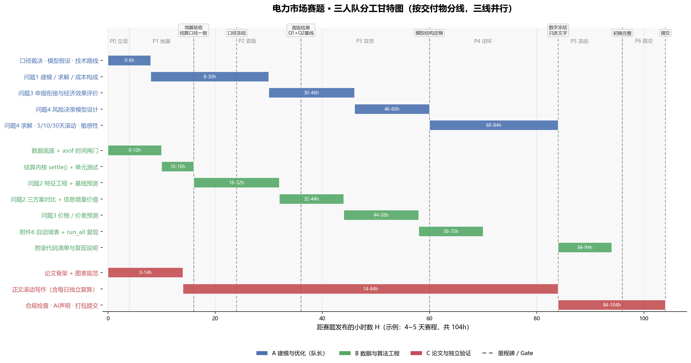

# 电力市场赛题 · 团队分工与执行方案

> **赛题**：华南理工大学第二十五届"三新集团杯"数理大赛 —— *电力市场中的用电申报与风险决策*
> **适用**：3 人队（4 人 / 2 人配置见 §3.3）；按 **4~5 天（约 104 小时）** 赛程设计，另附 72 小时压缩版映射（§4.3）
> **本文档定位**：不是解题论文，而是"谁在什么时间交出什么、彼此怎么对接"的作战地图

---

## 0. 一页速览

| 要点 | 结论 |
|---|---|
| 分线方式 | **按交付物分线，不按题号分人**：优化线(Q1→Q4) / 预测线(Q2→Q3) / 写作与验证线(全程) |
| 三个角色 | A 建模与优化（队长）· B 数据与算法工程 · C 论文与独立验证 |
| 唯一共享内核 | `settle()` 结算函数 + 统一长表 schema，**全队只允许一份实现** |
| 两次硬冻结 | **H+24 结算口径与数据底座冻结**；**H+84 全部数字冻结**（之后只改文字） |
| 关键路径 | M0 数据底座 → Q2 预测 → Q3 价格 → Q4 风险决策 → 论文整合 |
| 最大的坑 | 附件数据有 **T+2 / T+4 / T+6 的披露延迟**，用错一步 = 未来信息泄漏，Q3/Q4 结论全部失效 |
| 最大的浪费 | 最后一天才写论文、手抄数字、三个人各写一套结算代码 |

**三条铁律**

1. **接口先行**：先定数据格式、函数签名、输出文件路径，再各自开工；谁都不许私自改接口。
2. **一人一主责一备份**：每个模块有唯一负责人和唯一备份人，关键路径上永远不能出现"等某一个人"。
3. **数字必须可追溯**：论文里出现的每个数字，都要能被 `outputs/` 下某个 CSV 或脚本复现出来。

---

## 1. 先把赛题拆成可并行的模块

读题后最忌讳"三个人一起想模型、一起调参、没人搭管道"。先把工作拆成 **8 个可独立验收的模块**：

| 编号 | 模块 | 具体内容 | 依赖 | 工时(人·h) | 主责 |
|---|---|---|---|---|---|
| M0 | 数据底座 | 6 个附件读入、长表化、缺失/异常处理、日期属性对齐、信息可得时间切片 `asof()` | — | 10 | B |
| M1 | 结算内核 | 中长期电费、日前偏差电费、实时偏差电费、$R_t$ 回收，逐时段成本函数 + 单元测试 | M0 | 6 | B |
| M2 | **问题 1** 确定性优化 | 24 时段最优申报 $q_t$、成本构成、价差/调整额度/$\lambda_0$ 的敏感性 | M1 | 14 | A |
| M3 | **问题 2** 用电量预测 | 规律分析、特征工程、方案 A/B/C 三档信息条件、逐日滚动回测、增量价值 | M0 | 22 | B |
| M4 | **问题 3** 价格与价差预测 + 确定性申报 | $P^{DA},P^{RT},S$ 三类预测、直接法 vs 间接法、接到 Q2 结果做申报、经济效果评价 | M2,M3 | 24 | B(预测)+A(申报) |
| M5 | **问题 4** 风险决策系统 | 不确定性刻画、CVaR 等风险度量、两阶段随机/分布鲁棒优化、5/10/30 天逐日滚动、敏感性 | M2,M4 | 30 | A |
| M6 | 结果文件与一键复现 | 自动填满附件 6（153×24 行）、`run_all.py`、README、环境清单 | M1~M5 | 8 | B |
| M7 | 论文与合规 | 论文主线、图表规范、数字一致性核验、匿名、AI 声明、附录清单、打包提交 | 全程 | 26 | C |

> **为什么 M6 必须单独成模块**：附件 6 要求问题 2~4 的结果覆盖 **2026-04-01 至 08-31 共 153 天 × 24 时段 = 3672 行**，还要按模板列名对齐。手工填表在最后一天几乎必然出错，必须 Day 1 就写出"结果 → xlsx 模板"的自动填充器。

**优先级（时间不够时按此砍）**

- **P0 保命**：M0 / M1 / M2 / M3 / 附件 6 表格填满 / 论文有完整结构和结果
- **P1 拿分**：M4 经济效果对比 / M5 主结果（含 5、10、30 天）/ 敏感性分析
- **P2 加分**：模型创新点、鲁棒性深挖、更漂亮的图表与故事线

---

## 2. 依赖关系与关键路径

```
M0 数据底座 ──┬─ M1 结算内核 ──┬─ M2 问题1 ───────────────┐
              │                │                          │
              ├─ M3 问题2 预测 ─┴─ M4 问题3 预测+申报 ────┼─ M5 问题4 ── M6 结果/复现 ── M7 论文
              │                                           │
              └────────────── 全程：C 的写作与验证线 ──────┘
```

**关键路径** = M0 → M3 → M4 → M5 → M7。
含义很直接：

- **Q2 的"粗糙但可用"版本必须在 H+36 前出来**，否则 Q3、Q4 全线延迟；预测精度可以后补，接口不能后补。
- **Q1 是"独立可交付"的**（附件 1 给了完全信息），它不阻塞任何人，因此适合放在第一阶段由 A 独立快速拿下，同时给全队提供"结算函数是否正确"的验证样本。
- **C 的写作不是最后做**，而是从 H+36 起每天产出"已完成部分的 1 页"，否则摘要写不出来。

---

## 3. 角色分工（3 人标准配置）

### 3.1 角色卡

#### A · 建模与优化（队长 / 技术决策人）

| 项 | 内容 |
|---|---|
| 主责 | M2、M5；M4 的"申报决策"部分 |
| 每日交付 | 模型假设 1 页、公式推导、可运行求解脚本、结果表 |
| 决策权 | 模型口径最终裁定（争议不过夜，当日站会定）、技术路线取舍 |
| 明确不碰 | 数据清洗细节、附件 6 填表、论文排版（避免成为瓶颈） |
| 验收标准 | 结果可被 B 的 `run_all.py` 复现；关键结论能用 3 句话讲清 |

#### B · 数据与算法工程

| 项 | 内容 |
|---|---|
| 主责 | M0、M1、M3、M6；M4 的价格/价差预测 |
| 每日交付 | 可复现的数据管道、预测指标表、结果文件、图表数据源 |
| 关键职责 | 维护 `asof()` 时间闸门（全队唯一），保证无未来信息泄漏 |
| 明确不碰 | 论文正文表达、模型故事包装 |
| 验收标准 | 任意一天删库重跑，`run_all.py` 能在 30 分钟内产出全部结果 |

#### C · 论文与独立验证

| 项 | 内容 |
|---|---|
| 主责 | M7；摘要与故事线；图表规范；合规 |
| 特殊职责 | **独立复算**：用不共享的实现（Excel 或独立小脚本）抽查 A、B 的关键数字，误差 > 1 元即打回 |
| 每日交付 | 论文增量页、图表清单（图号—数据源—结论）、问题清单 |
| 决策权 | 提交否决权（合规不达标可直接拦下） |
| 明确不碰 | 主模型代码（保持独立性，才能验出来） |

### 3.2 RACI 表（R 执行 / A 负责 / C 咨询 / I 知会）

| 模块 | A | B | C |
|---|---|---|---|
| M0 数据底座 | C | **R/A** | I |
| M1 结算内核 | C | **R/A** | C（独立复算） |
| M2 问题 1 | **R/A** | C | C |
| M3 问题 2 | C | **R/A** | I |
| M4 问题 3 | A（申报） | **R/A**（预测） | C |
| M5 问题 4 | **R/A** | R（场景/回测） | C |
| M6 结果/复现 | I | **R/A** | C（验收） |
| M7 论文 | C | C | **R/A** |
| 合规与打包 | I | C | **R/A** |

### 3.3 其他队伍规模的替换配置

| 规模 | 配置 | 说明 |
|---|---|---|
| **4 人** | 增设 D「可视化与工具」：图表模板、附件 6 填表器、交互式检查页 | A 专注 Q4，C 专注写作+验证，D 承担 M6 与全部出图 |
| **5 人** | 在 4 人基础上拆 D 为「工程」+「写作助理」 | 注意增人只在 M3/M5 有边际收益，写作线超过 2 人反而互相等待 |
| **2 人** | A：Q1+Q4 全部模型；B：数据+预测+写作支撑 | 取消"独立验证"，改为每日 30 分钟交叉复算；Q4 收敛为单场景 + CVaR |

---

## 4. 时间轴与里程碑

以 **H = 赛题发布时刻** 计。每个阶段都有"判据"，**不达标就当场砍功能，不许延期**。



### 4.1 阶段表

| 阶段 | 时间窗 | 目标 | 主责 | Gate 判据（必须全部满足才进入下一阶段） |
|---|---|---|---|---|
| **P0 立项** | 0–4h | 读题、数据摸底、分工确认、口径争议清单 | 全员 | ① 6 个附件全部成功读入并打印形状 ② 三角色确认 ③ 5 个口径争议有默认处理方案 |
| **P1 地基** | 4–16h | M0+M1 完成；目录/仓库/模板就绪 | B | ① `settle()` 在附件 1 某典型日与手算逐时段一致（误差<1元）② 长表 schema 冻结 ③ `asof()` 通过抽查 |
| **P2 首版** | 16–36h | Q1 完整结果；Q2 基线可用；论文章节骨架 | A / B / C | ① Q1 最优申报表 + 成本构成图 ② Q2 在 153 天回测上有 MAE ③ 论文前三节成文 |
| **P3 攻坚** | 36–60h | Q3 预测与确定性申报；Q4 模型定稿 | A / B | ① 直接价差 vs 间接价差两法对比表 ② Q4 目标函数与风险度量公式定稿 ③ 附件 6 填表器跑通 |
| **P4 闭环** | 60–80h | Q4 5/10/30 天滚动结果；敏感性分析；论文 70% | A / B / C | ① 三个周期结果表齐全 ② 至少 3 组敏感性 ③ 论文主体完成 |
| **P5 冻结** | 80–96h | **数字冻结（H+84）**；论文初稿完整 | C | ① 论文所有数字可追溯到 outputs ② 图全部定稿 ③ 摘要成文 |
| **P6 提交** | 96–104h | 合规检查、打包、提交 | C | 见 §7 检查清单全部打勾 |

### 4.2 每日节奏

| 时间 | 形式 | 内容 |
|---|---|---|
| 09:00 | 站会 15 min | 昨天完成 / 今天要交 / 卡在哪（只说阻塞，不讨论方案） |
| 14:00 | 同步 15 min | 只做接口对齐与口径冲突裁决 |
| 22:00 | 收尾 20 min | 合并分支、留一份当日结果快照、更新"已完成/未完成"看板 |

### 4.3 若只有 72 小时（压缩映射）

| 原阶段 | 压缩后 | 做法 |
|---|---|---|
| P0+P1 | 0–12h | 数据管道与结算函数并行赶工，EDA 只做 1 页 |
| P2 | 12–28h | Q1 与 Q2 基线并行 |
| P3 | 28–48h | Q3 只做"间接法"；Q4 直接上 CVaR + 场景法，不做分布鲁棒 |
| P4 | 48–62h | 只做 10 天滚动，敏感性减到 2 组 |
| P5+P6 | 62–72h | 论文只保留 P0 必需章节，附录给完整代码 |

**明确砍掉**：鲁棒优化对照实验、多模型集成、精细的可视化动画。**绝不砍**：附件 6 填满、代码可运行、合规与 AI 声明。

---

## 5. 协作机制（让三条线并行而不打架）

### 5.1 仓库与文件约定

```
project/
├─ data/raw/            # 赛题原始附件，只读，任何人不得修改
├─ data/interim/        # 清洗后长表（parquet 或 csv）
├─ src/common/          # io.py  features.py  settle.py  metrics.py  asof.py
├─ src/q1/ q2/ q3/ q4/  # 每问一个目录，禁止跨目录改别人的文件
├─ outputs/             # 所有结果 csv + figures/ + 附件6_提交版.xlsx
├─ paper/               # 论文 tex/docx 与图
├─ run_all.py           # 一键复现
└─ README.md            # 环境、依赖、运行顺序
```

**命名规范**：`outputs/q2_forecast_20260831.csv`（问题号_内容_日期）。**禁止**：`最终版.xlsx`、`新建文件夹(2)`、桌面散落文件。

**分支策略**：每人一条 `feat/A`、`feat/B`、`feat/C`，每天 22:00 合并到 `main`；`main` 上永远保持"可跑通"。没有 git 就用"每日 22:00 打 zip 快照"替代，快照命名 `snapshot_H+24.zip`。

### 5.2 三份接口契约（第一天必须白纸黑字定下来）

**契约 1 · 长表 schema**（所有中间数据的唯一格式）

```
date(str, YYYY-MM-DD) | hour(int, 0-23) | <指标列若干(float)>
```

**契约 2 · 结算函数**（全队唯一实现，放在 `src/common/settle.py`）

```python
def settle_day(q, L, p_da, p_rt, qc, pc, lam0=0.20) -> dict:
    """q, L, qc: 24 维 MWh；p_da, p_rt, pc: 24 维 元/MWh
    返回 {"contract":..., "da_dev":..., "rt_dev":..., "recovery":..., "total":...}"""
```

逐时段成本恒等式（必须写成单元测试）：

$$
C_t = \underbrace{Q^c_t P^c_t}_{\text{中长期合约}} + \underbrace{(q_t-Q^c_t)P^{DA}_t}_{\text{日前偏差}} + \underbrace{(L_t-q_t)P^{RT}_t}_{\text{实时偏差}} + R_t
$$

$$
R_t=\begin{cases}
[q_t-(1+\lambda_0)L_t]\,S_t, & q_t>(1+\lambda_0)L_t,\ S_t>0\\
[(1-\lambda_0)L_t-q_t]\,(-S_t), & q_t<(1-\lambda_0)L_t,\ S_t<0\\
0, & \text{其他}
\end{cases},\qquad S_t=P^{RT}_t-P^{DA}_t
$$

**契约 3 · 结果文件**（直接对齐附件 6 的列名，避免最后返工）

| 文件 | 列 |
|---|---|
| `outputs/q2_forecast.csv` | date, hour, pred_A, pred_B, pred_C, pred_final |
| `outputs/q3_price.csv` | date, hour, pred_da, pred_rt, spread_direct, spread_calc, spread_final |
| `outputs/q4_bid.csv` | date, hour, bid_det, bid_risk, risk_measure, risk_param, scheme_id |

### 5.3 信息可得时间闸门（本题最容易翻车的地方）

附件里的"可获得日期"列经实测：

| 数据 | 披露延迟 | 对 D 日申报（D-1 决策）可用的最新数据 |
|---|---|---|
| 附件 2 实际用电量 | **T+4** | 只能用到 **D-5** |
| 附件 3 平台实际运行信息 | **T+2** | 只能用到 **D-3** |
| 附件 3 平台预测信息 | **T-1**（前一日发布） | 可用到 **D-1** |
| 附件 4 日前/实时价格 | **T+6** | 只能用到 **D-7** |
| 附件 5 中长期合约 | 事前已知 | 全部可用 |

**规定**：所有特征构造必须经过 `asof(day)` 一次切片；**任何人不得直接 `df.lag(1)`**。C 每天抽 3 个日期手工核对"该用哪些行"，这是唯一能防住"未来信息泄漏"的机制——而泄漏一旦被评委看出，Q3、Q4 的结论会被整体质疑。

### 5.4 复现与留痕

- 所有随机过程固定 `seed`，写进 README；
- 每次跑出结果，同时保存 `outputs/_meta/run_时间戳.json`（记录参数、数据版本、git commit）；
- 论文里的每个数字旁边（草稿阶段）标注来源文件名，投稿前统一删除。

---

## 6. 论文分工与写作流水线

| 章节 | 主笔 | 素材来源 | 截止 |
|---|---|---|---|
| 摘要 | C（A 提供三句结论） | 全文 | H+92（最后写） |
| 问题重述与分析 | C | 赛题 | H+20 |
| 模型假设与符号 | A | 口径清单 | H+16 |
| 问题 1 模型与结果 | A | M2 | H+36 |
| 问题 2 模型与结果 | B | M3 | H+52 |
| 问题 3 模型与结果 | B（A 写申报部分） | M4 | H+64 |
| 问题 4 模型与结果 | A | M5 | H+80 |
| 敏感性 / 鲁棒性 | A+B | M5 | H+82 |
| 模型评价与推广 | C | 全文 | H+88 |
| 附录（代码清单、文件清单） | B 出，C 校验 | 仓库 | H+94 |

**图表规范（C 统一定义，避免风格打架）**

- 一张图 = 一个结论，图题写"结论"而不是"变量名"；
- 每张图必须有对应的 `outputs/` 数据文件，图由脚本生成，**不许手工调整数据点**；
- 全队共用一套配色与字号（存放在 `src/common/plot_style.py`）；
- 论文中的表，优先放"可直接对照附件 6"的结果表。

**写作节奏**：H+36 起，每天至少推进 1 页"已完成部分"，保证论文始终领先结果半步——这样模型一改，文字只需替换数字，不会推倒重来。

---

## 7. 提交前检查清单（H+96 起逐项打勾）

**内容完整性**

- [ ] 附件 6 的每个 sheet 都填满，行数对齐（问题 2~4 各 3672 行，问题 1 为 120 行），日期/时段格式统一
- [ ] 论文中每个数字都能在 `outputs/` 找到来源（跑一遍 `check_numbers.py` 自动比对）
- [ ] 四个问题都有"模型 + 结果 + 分析"三件套，没有只给结果不给解释的章节

**可运行性**

- [ ] `run_all.py` 在**干净目录**（换一台机器或新建虚拟环境）30 分钟内跑通
- [ ] 依赖清单、数据路径、运行顺序在 README 写清
- [ ] 附录贴的是**完整可运行源码**，不是片段或截图

**合规**

- [ ] 全文匿名：无校名、无姓名、无学号、无本机绝对路径；文件属性/批注/修订记录已清
- [ ] AI 工具使用声明据实二选一；若使用，附 `AI工具使用详情.pdf`（工具名称版本、用途环节、提示方式、采纳与人工核验情况）
- [ ] 附录 A 支撑材料清单与压缩包内容**逐项一致**
- [ ] 正文 ≤ 30 页，摘要 1 页，PDF ≤ 20MB（不压缩），支撑材料 ≤ 20MB

**最后 4 小时**

- [ ] 停止一切模型改动（H+84 已冻结）
- [ ] 两人交叉通读全文，只改错别字与病句
- [ ] 打包 → 解压 → 再检查一次 → 提交

---

## 8. 风险与预案

| 风险 | 早期征兆 | 预案 | 触发人 |
|---|---|---|---|
| Q4 随机优化跑不动 | H+60 单次求解 > 10 分钟 | 场景缩减到 50 个 → 线性化 → 退化为"单期 CVaR + 情景枚举" | A |
| 预测精度不如基线 | 回测指标劣于"昨日同时段" | 保留基线作为方案 A，论文中如实对比并分析原因 | B |
| 数据异常/缺失 | EDA 发现连续零值、跳变 | 统一插值规则写进 `common`，论文假设中声明 | B |
| 队员掉线/生病 | 站会缺席 2 次 | 备份人 2 小时内接管其分支，主线不做大改 | A |
| 时间不够 | P3 Gate 未通过 | 启动 §4.3 压缩方案，砍 P2 功能 | A |
| 口径反复变 | 同一指标出现两种算法 | 站会裁决 + 写进 `DECISIONS.md`，改口径必须重跑受影响结果 | A |
| 环境/机器故障 | 求解器报错、内存溢出 | 代码不依赖 GPU，结果每日快照，备用机提前装好环境 | B |

---

## 9. 附：赛题里必须第一天定下的 5 个口径

分工能否顺利，八成取决于这 5 件事有没有当场定死。建议直接抄成 `DECISIONS.md`：

| # | 争议点 | 建议默认处理 | 负责人 |
|---|---|---|---|
| 1 | 附录 1 只写了结算与 $R_t$，"申报约束"具体指什么？ | 显式写出 $q_t\ge 0$、$q_t\le \bar q$（自定上限）与 $\lambda_0=20\%$ 的经济软约束，并在假设中说明 | A |
| 2 | "每日总调整额度"如何定义？ | 定义为 $\sum_t\lvert q_t-Q^c_t\rvert \le K$（或 $\sum_t(q_t-Q^c_t)$），$K$ 作为敏感性参数而非硬约束 | A |
| 3 | $R_t$ 的符号与计入方式 | $R_t\ge 0$ 视为"收益回收"，**加到**总成本上（附件 6 列名为"偏差风险调整费用"） | A+C |
| 4 | 决策时刻定在 D-1 几点？ | 定在 D-1 日末，据此确定 §5.3 的可用数据边界 | B |
| 5 | 预测评价指标 | 主指标 MAE，辅以 MAPE（避开零值）与分时段/分日期类型误差；基准模型提前指定 | B+C |

**一个会导致模型退化的坑（务必写进假设）**：在 $S_t>0$ 且 $q_t>(1+\lambda_0)L_t$ 时，目标函数对 $q_t$ 的斜率恰好为 0（$P^{DA}-P^{RT}+S=0$），$S_t<0$ 且 $q_t<(1-\lambda_0)L_t$ 时同理。也就是说，**越过允许偏差带后成本是一条平台**，最优 $q_t$ 不唯一，Q1 的结果将不可复现、也无法比较策略优劣。因此**必须先定义申报上限或调整额度约束**，再谈"最优申报电量"。这一条如果没有提前发现，会在 P4 阶段把 Q1、Q3、Q4 三处结果同时推翻。

---

*文档版本 v1.0 · 建议在开赛 4 小时内由全队通读一遍并确认角色与时间窗，之后只更新 §8 风险表和 §9 决策记录。*
